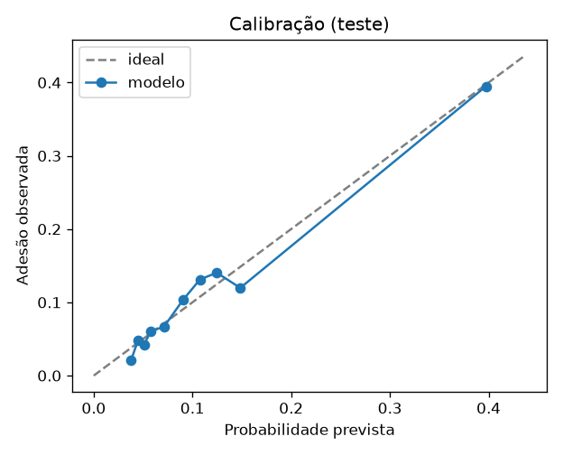

# Quem devemos contatar primeiro?

**Previsão de adesão a depósito a prazo com Aprendizado de Máquina**

Projeto N3 · Aprendizado de Máquina · Prof. Fabiola Pinho Magalhães

**Integrantes:** Miguel, Julia, Ana Olska e Ana Paula

## Introdução

Campanhas de telemarketing bancário têm baixa conversão: na base estudada, cerca de 11 em cada 100 contatos terminam em contratação. Ligar em qualquer ordem gasta o tempo da equipe e incomoda clientes sem interesse.

**Objetivo:** estimar, antes da ligação, a chance de um cliente contratar um depósito a prazo e transformá-la em prioridade de contato (alta, média ou baixa).

**Quem poderia utilizar:** equipes de relacionamento e de telemarketing de um banco, para organizar a fila de ligações.

## Principais resultados

Avaliação em 8.236 contatos de teste, com perfis que não aparecem no treino:

| Medida | Sem modelo | Com modelo |
|---|---:|---:|
| AUC-ROC | 0,500 | **0,737** |
| AUC-PR | 0,113 | **0,369** |
| Contratações a cada 100 ligações priorizadas | 11 | **26** |
| Contratações encontradas com 21% das ligações | 21% | **47%** |

Na prática, a fila de prioridade alta rende **2,3 vezes** mais que ligar ao acaso.

## Como executar

Requer Python 3.14, versão em que o projeto foi testado. Na pasta do projeto, no Windows:

```powershell
python -m venv .venv
.venv\Scripts\python -m pip install -r requirements.txt
.venv\Scripts\python -m streamlit run app.py
```

No Linux ou macOS, troque `.venv\Scripts\python` por `.venv/bin/python`.

O modelo treinado já está no repositório. Para refazer tudo:

```powershell
.venv\Scripts\python -m src.treinar    # treina e avalia (1 a 2 minutos)
.venv\Scripts\python -m pytest         # testes automáticos
```

A explicação passo a passo, com gráficos e saídas, está em [notebooks/projeto_n3.ipynb](notebooks/projeto_n3.ipynb).

## Organização

```
app.py                  demonstração em Streamlit
notebooks/              desenvolvimento explicado, já executado
src/dados.py            carga, limpeza e separação
src/modelos.py          pré-processamento e algoritmos
src/avaliacao.py        métricas e análise de erros
src/treinar.py          comparação, escolha e avaliação
src/previsao.py         validação e previsão de uma nova entrada
dados/                  dataset original
modelos/                modelo treinado
resultados/             métricas, tabelas e figuras
testes/                 testes automáticos
```

## Dados

Bank Marketing, do UCI Machine Learning Repository (Moro; Rita; Cortez, 2014), arquivo `bank-additional-full.csv`, licença CC BY 4.0. São 41.188 contatos e 20 atributos de um banco português, de maio de 2008 a novembro de 2010. O alvo `y` indica se o cliente contratou.

## Conceitos utilizados

- **Classificação supervisionada:** o modelo aprende com exemplos cujo resultado é conhecido.
- **Vazamento de dados:** usar informação que não existiria no momento da previsão.
- **Validação cruzada por grupo:** avaliar em várias divisões do treino, sem repetir o mesmo perfil nos dois lados.
- **Precisão:** de quem foi priorizado, quantos contrataram. **Revocação:** de quem contratou, quantos foram priorizados.
- **AUC-PR:** resume precisão e revocação em todos os cortes. É adequada à classe rara.
- **AUC-ROC:** chance de um contratante receber score maior que um não contratante.
- **Calibração:** entre clientes com 30% de chance prevista, cerca de 30% devem contratar. O **Brier** mede o erro dessa probabilidade.

## Preparação e escolhas

- Removemos 12 duplicatas exatas e mantivemos `unknown` como categoria.
- O modelo usa 11 entradas sobre perfil, situação financeira, canal e histórico de contato.
- Excluímos `duration`, que só existe depois da ligação.
- Excluímos mês, dia e indicadores econômicos, que descrevem o momento e não o cliente. Também excluímos `pdays`, cujo histórico já está representado em outras colunas.
- Separamos 80% para treino e 20% para teste, com estratificação e agrupamento por perfil. A base não tem ID de cliente.
- Numéricas são padronizadas e categóricas passam por one-hot, dentro de um pipeline ajustado só no treino.
- Não balanceamos as classes, para preservar o significado da probabilidade.

## Comparação dos modelos

Validação cruzada de 5 dobras, somente no treino:

| Modelo | AUC-PR | AUC-ROC | Brier |
|---|---:|---:|---:|
| **Gradient Boosting (escolhido)** | **0,369** | **0,736** | **0,086** |
| Random Forest | 0,368 | 0,735 | 0,086 |
| Regressão Logística | 0,353 | 0,729 | 0,087 |
| Árvore de Decisão | 0,317 | 0,713 | 0,087 |
| Referência (taxa média) | 0,113 | 0,500 | 0,100 |

O critério foi a maior AUC-PR média. Gradient Boosting e Random Forest empatam na prática, pois a diferença é menor que a variação entre as dobras.

## Avaliação e erros

O corte de prioridade alta foi definido no treino, para selecionar cerca de 20% dos contatos.

| No teste | Priorizado | Não priorizado |
|---|---:|---:|
| **Contratou** | 432 acertos | 496 falsos negativos |
| **Não contratou** | 1.261 falsos positivos | 6.047 acertos |

| Faixa | Contatos | Adesão real |
|---|---:|---:|
| Alta | 1.693 | 25,5% |
| Média | 2.485 | 12,3% |
| Baixa | 4.058 | 4,7% |



O que mais influencia o modelo é o resultado da campanha anterior, seguido de idade e canal.

Os erros não se distribuem igualmente. O modelo encontra apenas 11% dos operários e 11% dos contatos por telefone fixo que contrataram. Entre maiores de 60 anos encontra quase todos, mas gera muitas ligações sem retorno.

### Teste no tempo

Treinando nos 80% mais antigos e testando nos 20% mais recentes, a AUC-ROC cai para **0,691** e o ganho sobre o acaso para **1,3 vez**. A probabilidade média prevista é 15,0%, e a adesão real é 30,8%. Ou seja, o modelo ainda ordena razoavelmente, mas **precisa ser retreinado e recalibrado quando o cenário muda**.

## Demonstração de uso

A interface recebe os dados de um cliente e devolve a chance estimada, a prioridade, a ação recomendada e a comparação com a média. Entradas impossíveis ou contraditórias são recusadas, e casos raros recebem um alerta.

| Exemplo incluído | Chance | Prioridade |
|---|---:|---|
| Aposentado(a), 68 anos, já contratou antes | 67,7% | Alta |
| Técnico(a), 35 anos, sem histórico | 10,7% | Média |
| Operário(a), 42 anos, telefone fixo | 3,7% | Baixa |

## Limitações

- Os dados são de um banco português em 2008–2010 e não representam o Brasil atual.
- O modelo identifica associações, não causas: mudar o canal de um cliente não garante maior adesão.
- O agrupamento por perfil reduz, mas não garante eliminar, a repetição de clientes entre treino e teste.
- O dataset já era conhecido do grupo por um trabalho anterior, então o teste não é totalmente inédito.
- Idade, profissão e estado civil podem gerar tratamento desigual. Um uso real exige análise ética e de LGPD, além de ligações reservadas fora do ranking.

## Considerações finais

O projeto mostra que é possível melhorar a ordem das ligações apenas com informações conhecidas antes do contato, chegando a mais que o dobro de conversão na fila prioritária dentro do período estudado. O resultado dependeu tanto do algoritmo quanto das decisões sobre os dados: evitar vazamento, escolher métricas adequadas ao desbalanceamento, manter probabilidades interpretáveis e analisar quem é prejudicado pelos erros. O teste temporal mostra o principal limite da solução. Como continuidade, propomos dados recentes, recalibração periódica e um experimento controlado com a equipe de atendimento.

## Origem do projeto

Este trabalho aprofunda uma aplicação feita para o Trabalho N3 de Análise Preditiva, o [pipeline MLOps de Bank Marketing](https://github.com/weillerjulia/n3-mlops-bank-marketing).

- **Reaproveitado:** problema, dataset, remoção de `duration` e das duplicatas e a ideia de priorizar 20% dos contatos.
- **Novo:** código, seleção de entradas, divisão por perfil, comparação de cinco modelos, probabilidades sem balanceamento, análise de erros e calibração, teste temporal deste modelo e aplicação interativa.

## Referências

- BREIMAN, L. Random forests. *Machine Learning*, v. 45, n. 1, p. 5–32, 2001. https://doi.org/10.1023/A:1010933404324
- FRIEDMAN, J. H. Greedy function approximation: a gradient boosting machine. *The Annals of Statistics*, v. 29, n. 5, p. 1189–1232, 2001. https://doi.org/10.1214/aos/1013203451
- KAUFMAN, S. et al. Leakage in data mining: formulation, detection, and avoidance. *ACM Transactions on Knowledge Discovery from Data*, v. 6, n. 4, p. 1–21, 2012. https://doi.org/10.1145/2382577.2382579
- MORO, S.; CORTEZ, P.; RITA, P. A data-driven approach to predict the success of bank telemarketing. *Decision Support Systems*, v. 62, p. 22–31, 2014. https://doi.org/10.1016/j.dss.2014.03.001
- MORO, S.; RITA, P.; CORTEZ, P. *Bank Marketing* [dataset]. UCI Machine Learning Repository, 2014. https://doi.org/10.24432/C5K306
- NICULESCU-MIZIL, A.; CARUANA, R. Predicting good probabilities with supervised learning. In: INTERNATIONAL CONFERENCE ON MACHINE LEARNING, 22., 2005. p. 625–632. https://doi.org/10.1145/1102351.1102430
- PEDREGOSA, F. et al. Scikit-learn: machine learning in Python. *Journal of Machine Learning Research*, v. 12, p. 2825–2830, 2011. https://jmlr.org/papers/v12/pedregosa11a.html
- SAITO, T.; REHMSMEIER, M. The precision-recall plot is more informative than the ROC plot when evaluating binary classifiers on imbalanced datasets. *PLOS ONE*, v. 10, n. 3, e0118432, 2015. https://doi.org/10.1371/journal.pone.0118432
